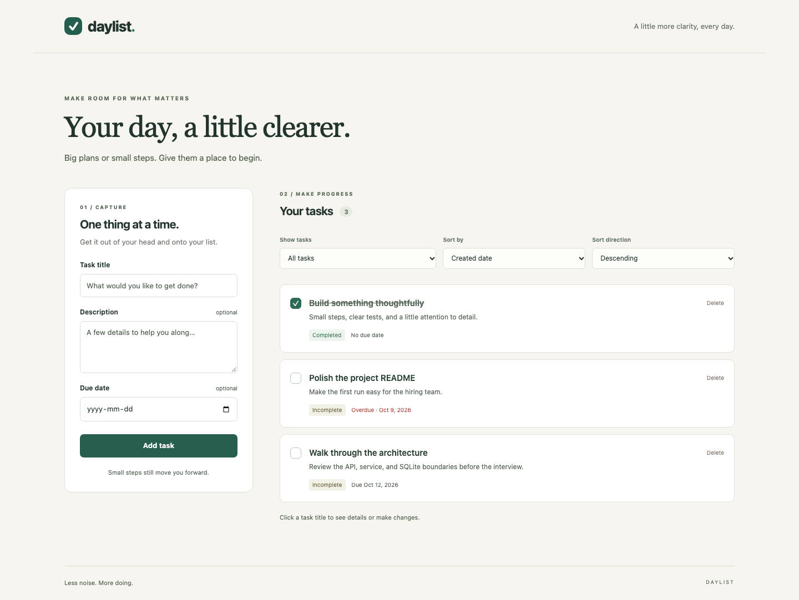

# Daylist

A small to-do application built for the Foci Solutions take-home: React and
TypeScript in the browser, FastAPI at the HTTP boundary, and SQLite for durable
storage. Create, inspect, edit, complete, reopen, and delete tasks; filter by
status or overdue date; sort by creation date, due date, or title.

All optional assignment enhancements are included: filtering, sorting, input
validation, and Docker packaging. The app starts empty and stores only the tasks
you create.



*Example tasks shown for illustration; the application starts empty.*

## Quick start with Docker

Requires Docker Engine/Desktop with Compose:

```sh
docker compose up --build
```

Open <http://localhost:8000>. Interactive API documentation is at
<http://localhost:8000/docs>. Compose binds the app to localhost and persists
SQLite in the `todo-data` named volume. `docker compose down` stops the app and
preserves tasks. `docker compose down -v` also **permanently deletes its tasks**.
The runtime container runs as a non-root user.

## Run locally

Requirements: Python 3.11+ and Node.js 24 LTS with npm. From the repository root:

```sh
python3 -m venv backend/.venv
backend/.venv/bin/python -m pip install -r backend/requirements-dev.txt
npm ci --prefix frontend
```

Start the backend in one terminal:

```sh
cd backend
.venv/bin/uvicorn todo_app.main:app --reload --host 127.0.0.1 --port 8000
```

Start the frontend in another:

```sh
cd frontend
npm run dev
```

Open <http://localhost:5173>. Vite forwards `/api` to the backend. These shell
examples use macOS/Linux paths; on Windows use `backend\.venv\Scripts\python.exe`
and the corresponding `uvicorn.exe` executable.

The default database path is `data/todos.sqlite3` relative to the backend's working
directory (normally `backend/data/todos.sqlite3`). Set `TODO_DB_PATH` to choose
another path. Back up the database while the app is stopped. To reset local data,
stop the backend and remove that database file.

## Tests and checks

Backend service, SQLite integration, and HTTP contract tests:

```sh
cd backend
.venv/bin/pytest -q
.venv/bin/ruff check .
.venv/bin/ruff format --check .
```

Frontend interaction/API-client tests, formatting, TypeScript, and production build:

```sh
cd frontend
npm test
npm run format:check
npm run build
```

Browser acceptance tests run the real API and SPA in Chromium at desktop and mobile
sizes. They also check keyboard interaction and use axe for automated accessibility
checks (which supplement, rather than replace, manual inspection):

```sh
# From the repository root, after installing backend and frontend dependencies:
npm ci --prefix e2e
cd e2e
npx playwright install chromium
npm test
```

The test runner starts its own servers on ports 8001 and 4173 and a unique temporary
SQLite database, removed afterward. Leave those ports free. It does not reuse a
running development server or its data. On Linux CI, install browser dependencies
with `npx playwright install --with-deps chromium`.

Container acceptance, including persistence after replacing the container:

```sh
# From the repository root:
docker build --load -t daylist:local .
python3 scripts/container_smoke.py --image daylist:local
```

The smoke test creates and cleans up its own uniquely named container and volume.
GitHub Actions runs backend, frontend, browser, and container checks.

## Design and testing approach

The backend is intentionally small: routes translate HTTP requests, Pydantic
schemas validate input, a task service handles behavior, and a task-specific
repository encapsulates parameterized SQLite statements and transactions. A
repository protocol and injected clock keep service rules independently testable.
The application factory creates isolated instances for integration tests.

SQLite provides persistent atomic writes without a separate database service or
ORM. React components use a typed API client. Development uses a proxy; the Docker
image serves the built SPA and API from one origin.

Specification-driven development establishes observable behavior in
[the specification](docs/SPEC.md) before implementation. TDD slices cover domain
rules, persistence, API behavior, and UI interactions, followed by real-browser
acceptance tests. Small commits capture working slices; observed test checkpoints
are recorded in [the development log](docs/DEVELOPMENT.md).

See [the implementation plan](docs/PLAN.md) and
[architecture decisions](docs/ARCHITECTURE.md) for scope and rationale.

## API at a glance

| Method | Endpoint | Purpose |
| --- | --- | --- |
| POST | `/api/todos` | Create a task; returns 201 and Location |
| GET | `/api/todos` | List tasks; returns an array |
| GET | `/api/todos/{id}` | Read details |
| PATCH | `/api/todos/{id}` | Edit fields or set completion |
| DELETE | `/api/todos/{id}` | Delete; returns 204 |
| GET | `/api/health` | Application health |

```sh
curl -X POST http://localhost:8000/api/todos \
  -H 'Content-Type: application/json' \
  -d '{"title":"Read the brief","dueDate":"2026-10-15"}'

curl 'http://localhost:8000/api/todos?status=incomplete&sort=dueDate&order=asc'
```

Use `PATCH` with `{"isCompleted":true}` or `{"isCompleted":false}` to set status.
Validation failures return 422, missing tasks return 404, and storage failures
return 503 without database details. The OpenAPI documentation describes request
and response schemas.

## Assumptions and tradeoffs

- **Single local user:** no authentication or user isolation. This assignment is
  not configured for public internet hosting.
- Titles are trimmed and required (1–200 characters); descriptions allow up to
  5,000 characters. Due dates are optional valid `YYYY-MM-DD` calendar dates.
- IDs and UTC creation timestamps are server-generated and immutable. Completion
  defaults to false. Unknown request fields and invalid boolean types are rejected.
- **Overdue uses UTC:** incomplete and due strictly before today's UTC date.
  Tasks due today are not overdue. Calendar dates are displayed without timezone
  conversion; a multi-user product would need a user-timezone policy.
- PATCH preserves omitted fields. Explicit null clears description or due date.
  Completion assignments are idempotent; deletion of a missing task returns 404.
- Default order is newest first. Missing due dates sort last in both directions;
  title sorting is case insensitive; ties use ascending ID.
- A personal task list is loaded in memory for filtering/sorting. Pagination,
  authentication, migrations, and collaborative editing were excluded to keep
  the solution proportional to the assignment.
- Dependencies are locked for reproducible installs. Native development requires
  two processes; Docker packages the app into one service.

## AI assistance

Codex agents assisted with planning, implementation, tests, and review. The shared
specification, development record, and commit history make that process visible.
The applicant should review and understand the code and design decisions before
submission, as requested in the assignment.
